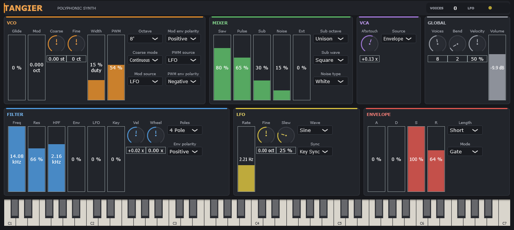

# Tangier

Tangier is a polyphonic virtual-analogue synthesizer plugin (VST3 and
standalone app). It is based on the **Interzone** module from
[Valley Audio's ValleyRackFree](https://github.com/ValleyAudio/ValleyRackFree)
for VCV Rack.



## Features

- One oscillator per voice: saw, pulse and sub at once
- Mixer with noise and an optional external audio input
- 2/4-pole OTA low-pass filter followed by a high-pass filter
- Looping ADSR envelope and a VCA
- One LFO shared by all voices, optionally key-synced
- Polyphonic, with a mono mode that returns to the previous held note
- MIDI control of pitch, pitch bend, velocity, mod wheel, aftertouch and sustain


## MIDI

Tangier replaces Interzone's CV inputs with MIDI:

| Interzone input | Tangier |
|---|---|
| V/Oct 1 | Note number (C4 = MIDI note 60) |
| V/Oct 2 | Pitch bend (range set by *Bend*) |
| Gate / Trig | Note on/off; each note-on retriggers the envelope |
| Filter Freq CV 1 / CV 2 | Velocity / mod wheel, scaled by the *Vel* / *Wheel* knobs |
| PWM input | Mod wheel (PWM source *Mod Wheel*) |
| VCA Level CV | Channel or polyphonic aftertouch, scaled by *Aftertouch* |
| Ext input | Optional "External" audio input bus (sidechain), level set by *Ext* |
| LFO Sync | *Key Sync*: restarts the LFO when a note is played with no other keys held |

The sustain pedal (CC 64) is supported. With *Voices* set to 1, Tangier plays
monophonically and returns to the previous held note on release.

## Building

Requirements: CMake 3.22 or newer and a C++20 compiler (developed with Visual
Studio 2026 on Windows). JUCE 9.0.5 is fetched with CMake FetchContent, so the
first configure needs network access.

```powershell
git clone https://github.com/duddex/tangier.git
cd tangier
cmake -S . -B build
cmake --build build --config Release
ctest --test-dir build -C Release --output-on-failure
```

The plugin is written to `build/Tangier_artefacts/Release/VST3/Tangier.vst3`
and the standalone app to `build/Tangier_artefacts/Release/Standalone/`.
Copy `Tangier.vst3` to `C:\Program Files\Common Files\VST3` to use it in a DAW.

## Releases

GitHub Actions builds and tests every push on Windows. Pushing a `v*` tag creates a release with a
zip of the VST3, the standalone app and the licence files.

## Licence

Tangier is free software: you can redistribute it and/or modify it under the
terms of the GNU General Public License as published by the Free Software
Foundation, either version 3 of the License, or (at your option) any later
version. See [`LICENSE`](LICENSE).

Tangier is based on GPLv3 code by Dale Johnson (Valley Audio). It uses JUCE
under the AGPLv3. See [`NOTICE.md`](NOTICE.md) for all copyright notices,
third-party licences and a list of changes from the original.

Tangier is not an official Valley Audio product.

## Credits

Designed and developed by [duddex](https://github.com/duddex) with the help of a
large language model (LLM).

Tangier is based on the Interzone module by Dale Johnson (Valley Audio), with the
looping ADSR derived from VCV Fundamental. Built on the [JUCE](https://juce.com)
framework.
